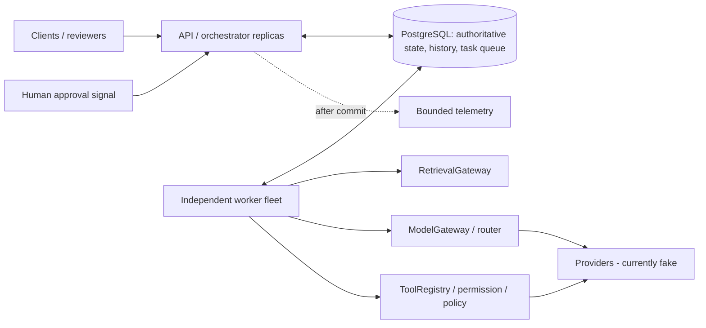

# DurableFlow

A Java/Spring Boot/PostgreSQL workflow and AI agent runtime built to study durable execution. It persists orchestration state, queues work transactionally, and separates short claim/completion transactions from external work. Leases, generation fencing, stable idempotency identities and checkpoints support recovery; the AI layer adds scoped retrieval, constrained model routing, policy-gated tools, human approval and durable budgets.

**Locally verified:** Java 21 compilation, executable packaging and the full default regression suite pass: **368 passed, zero failures/errors, one opt-in benchmark skipped** (369 selected). Flyway V1-V13, API startup, two independent workers, parallel DAG/Saga demos, retrieval-bound refund approval and bounded-agent termination were exercised. The synthetic golden suite passed **12/12 cases**. See the [verification board](docs/runtime-verification-progress.md), [recorded evidence](docs/verification/runtime-2026-10-26/regression.json) and [runtime checklist](docs/runtime-verification-checklist.md). This is local fake-provider verification; production readiness and universal exactly-once execution are not claimed.



## Guarantees and boundaries

- Atomic state/task/history transitions and unique logical identities; completed checkpoints are reused.
- Concurrent SKIP LOCKED claims, expiring leases/heartbeats and generation-fenced local outcomes.
- At-least-once physical attempts; effectively-once external effects require a cooperating idempotent provider.
- Persisted timer deadlines, early signal receipts, bounded retries and Saga compensation.
- Immutable tool requests and exact approval binding; persisted agent/model/token/cost reservations.

These contracts are exercised by the local regression suite; the evidence and remaining operational limits are recorded on the verification board. History is audit beside authoritative state, not an event-sourced replay log. API authentication/reviewer authorization is **not implemented**; signal/approval endpoints must be protected before production exposure.

## Features

| Area | Implemented | Deeper design |
| --- | --- | --- |
| Core | Versioned definitions, checkpoints, PostgreSQL queue, leases/fencing, retries/timeouts | [Queue](docs/postgres-task-queue.md), [leases](docs/task-leases.md), [idempotency](docs/idempotency.md) |
| Composition | Durable timers/signals, static DAG joins, Sagas, child workflows, schedules | [Architecture](docs/architecture.md), [DAG](docs/parallel-dag.md), [Saga](docs/saga-compensation.md) |
| AI | Scoped fake retrieval, frozen model routes/fallback, immutable tools, approvals, bounded agents | [RAG](docs/rag-retrieval.md), [routing](docs/model-routing-fallback.md), [agents](docs/bounded-agent-loop.md) |
| Quality | Bounded telemetry, synthetic golden evaluations, deterministic chaos scenarios | [Evaluation](docs/evaluation-observability.md), [chaos matrix](docs/chaos-matrix.md) |
| Hardening | Payload/graph limits, opt-in SQL benchmarks, deployment/security guidance | [Security](docs/security-resource-limits.md), [benchmarks](docs/benchmarks.md), [deployment](docs/deployment.md) |

## Quickstart

Requires JDK 21, Maven, Docker with a running Linux-container daemon, and Compose. No wrapper is committed. Local PostgreSQL uses the existing demo defaults; use environment/secret-manager credentials for real deployment. `.env.example` contains placeholders. Compose reads `.env`; Java processes need their own exported environment.

```powershell
# Use a PostgreSQL-compatible JVM timezone, including Maven's test JVMs.
$env:JAVA_TOOL_OPTIONS='-Duser.timezone=UTC'
java -version
mvn -version
docker version
docker compose up -d --wait postgres
mvn -B -DskipTests package
# API terminal
java -jar target/durableflow-0.0.1-SNAPSHOT.jar
# Separate worker terminal, same DB settings
$env:WORKER_ID='worker-local-1'
java -jar target/durableflow-0.0.1-SNAPSHOT.jar --spring.profiles.active=worker
```

## Core workflow example

[ParallelOrder](examples/parallel-order-v1.json) executes payment -> parallel fraud/inventory/risk checks -> join -> shipment, with configured compensation handlers.

```powershell
$api='http://localhost:8080/api'
Invoke-RestMethod -Method Post -Uri "$api/workflow-definitions" -ContentType 'application/json' -Body (Get-Content examples/parallel-order-v1.json -Raw)
$run=Invoke-RestMethod -Method Post -Uri "$api/workflow-runs" -ContentType 'application/json' -Body (Get-Content examples/start-parallel-order.json -Raw)
Invoke-RestMethod -Method Post -Uri "$api/workflow-runs/$($run.runId)/advance"
Invoke-RestMethod "$api/workflow-runs/$($run.runId)/events"
```

A start stores state; advancement authorizes ready work; the separate worker executes it. Duplicate definition registration conflicts by design. A GET immediately after advancement may still show RUNNING.

## AI refund agent example

The [refund fixture](examples/start-bounded-refund-agent.json) proposes read tools, then an O-42/4500 refund that must wait for an exact request-bound review. Provider calls run in the worker; the client script drives durable agent transitions.

```powershell
.\scripts\demo-bounded-agent.ps1 -Scenario refund -ApproveRefund
.\scripts\demo-bounded-agent.ps1 -Scenario runaway
.\scripts\run-evaluation.ps1
```

`-ApproveRefund` explicitly approves only the expected synthetic demo request. Omit it to pause for inspection. The [two demo stories](docs/demos.md) include retrieval-grounded agent input, crash recovery, timers/signals and compensation. All providers are local fakes; no real model key is needed.

## Tests, chaos and benchmarks

```powershell
mvn -B test
mvn -B '-Dtest=GoldenEvalIntegrationTest' test
.\scripts\run-chaos.ps1 -Scenario all
.\scripts\run-benchmarks.ps1 -Scenario queue -Workflows 1000 -Scaling
# Equivalent opt-in benchmark smoke command if scripts are unavailable:
mvn -B '-Dtest=BenchmarkIntegrationTest' '-Ddurableflow.benchmark=true' '-Dbench.workflows=20' test
```

Testcontainers uses isolated PostgreSQL databases. Benchmarks are disabled during ordinary tests. Reports go to ignored `target/`; no benchmark or passing eval report is committed. The benchmark measures service/SQL paths in one JVM, not production HTTP or multi-host capacity. Scripts may be blocked by local PowerShell policy; the equivalent Maven commands remain available once prerequisites are installed. See [SQL/index inspection](docs/sql-inspection.md).

## Structure and reading

```text
src/main/java/io/durableflow/
  workflow/       definitions, state, queue, timers, signals, Sagas, children, schedules
  worker/         claim/lease/heartbeat/fencing/retry/timeout execution
  ai/             retrieval, model gateway, routing and fake adapters
  tools/, agent/  host policy, approval, immutable requests, durable agent loop
  observability/, evaluation/, security/
src/main/resources/db/migration/  V1-V13
src/test/        unit/integration/chaos/golden tests and opt-in benchmark
examples/, scripts/, docs/
```

[Architecture](docs/architecture.md) | [Deployment](docs/deployment.md) | [Queue ADR](docs/adr/0001-postgresql-task-queue.md) | [Interview defense](docs/interview-defense.md) | [Resume material](docs/resume-project-summary.md). Historical session commands remain in the [development guide](docs/session-development-guide.md); earlier-session limitations there describe that stage, not the current design.

## Limitations and next steps

PostgreSQL primary/pool/polling/locks eventually constrain scale; no measured saturation point exists. Circuit breakers are per-instance, DAG topology is static, generation can repeat, and provider idempotency/retention is external. Prompt-injection controls are layered, not absolute. There is no real AI/MCP/vector integration, production auth, PostgreSQL HA/backup automation, external collector or complete readiness system. Inspection pagination/tenant quotas and general forward-run reconciliation are deferred; advancement and agent driving remain explicit where described in the deployment guide.

Major feature development ends at Session 27. Next: install runtime prerequisites, compile, fix real test failures, execute chaos/demos, collect representative benchmark evidence and restore drills, then update project/resume claims using actual results. No Kafka/Redis is added without a measured requirement.
