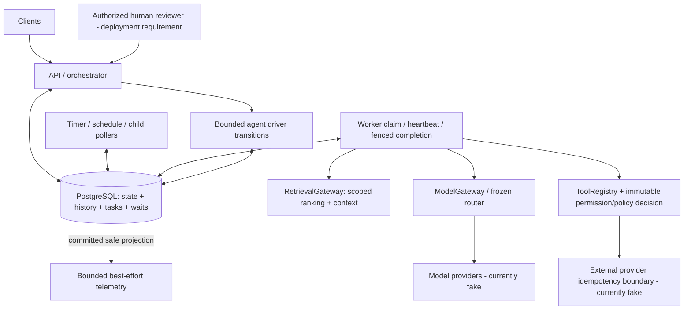

# DurableFlow architecture and guarantee boundaries

DurableFlow is a PostgreSQL-backed persisted state machine, not a JVM continuation system or an event-sourced replay engine. Definition versions, run/node status, task ownership, output checkpoints, waits, compensation, child/schedule relationships, tool requests and agent/route reservations are authoritative database state. Ordered history is transactionally coupled audit; logs/metrics are lossy diagnostics.

A start persists run/activities/history; `/advance` computes ready nodes and queues tasks without running handlers. A claim transaction locks an eligible task with SKIP LOCKED, acquires run state, records owner/generation/DB-time lease and commits. Provider work runs outside that transaction. Heartbeats extend only valid ownership. Completion verifies the current generation and nonexpired lease, commits outputs/state/history, then the worker advances downstream work. A crash between completion and advancement requires repeat advancement; no universal forward-run startup sweeper is implemented.

Retries preserve logical identity and availability deadlines with bounded backoff/jitter. Reclamation can re-execute physical work, so provider-owned durable idempotency is required for effectively-once effects. Fencing prevents stale local writes; it does not cancel an already-started external side effect or make model generation exactly-once. Legacy synchronous endpoints reject mixing with queued execution and do not offer the same worker lease semantics.

Timers persist not-before deadlines; signals persist exact-target single-use receipts even before waits. Static DAG joins require persisted predecessor satisfaction. Saga compensation settles in-flight forward siblings before eligible reverse-topological undo; compensation is a new fallible business action, not SQL rollback. Child workflows pin versions and persist links; recurring schedules persist unique occurrences with bounded catch-up.

Retrieval is an activity with scoped selected sources and frozen downstream context. Model generation is an activity; durable route/attempt records freeze constraints and account known usage/reservations. Providers and breakers are currently local fake integrations/per-instance heuristics. Tool proposal is untrusted data; schema, registry, permission, policy, exact human signal binding and immutable fingerprints authorize a separate worker action. MCP-style discovery is not authorization. Agents persist each bounded iteration and reserve budgets before provider work; driving the next transition remains explicit.

Session 27 adds registration/input guards and test/operations harnesses without a new state table, queue, provider or auth system. See [security](security-resource-limits.md), [deployment](deployment.md), [chaos](chaos-matrix.md), [queue ADR](adr/0001-postgresql-task-queue.md) and [status](project-status.md). All guarantees describe the implemented design/assertions; runtime validation and capacity evidence are still pending.
