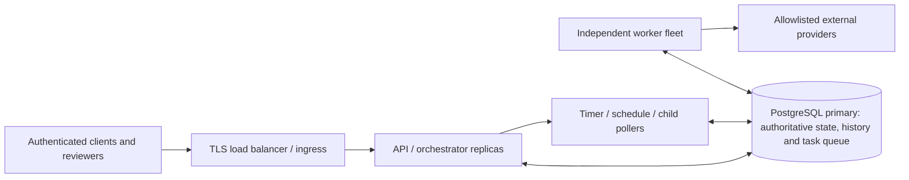

# First deployment design and operations

This is a deployment plan, not a deployment completed or production-ready certification. Finish [runtime verification](runtime-verification-checklist.md) before operating outside local demos.



API/orchestrator processes reconstruct work from persisted definitions, runs, outputs, waits and route/agent records; they do not restore old JVM stacks. Workers use the `worker` profile (`web-application-type: none`) and scale independently with unique IDs. PostgreSQL SKIP LOCKED coordinates claims; expiring leases/heartbeats and generation fencing govern long work. A worker is currently a bounded local execution slot, not an unlimited parallel executor. Measure multiple worker processes rather than assuming a large pool setting increases capacity.

Run the API with the default profile and workers with:

```powershell
mvn -B -DskipTests package
# Supply DB_URL/DB_USERNAME/DB_PASSWORD to BOTH shells via environment or a secret manager.
java -jar target/durableflow-0.0.1-SNAPSHOT.jar
# Separate shell; assign a distinct WORKER_ID for every worker replica.
$env:WORKER_ID='worker-local-1'
java -jar target/durableflow-0.0.1-SNAPSHOT.jar --spring.profiles.active=worker
```

Package/startup has not run here. For local convenience use `docker compose up -d --wait postgres`; the Compose file binds PostgreSQL to loopback and is not an HA/production manifest. Existing local fallback credentials must be replaced. Do not enable the dev profile on a public service. Add the ingress/authorization controls in [security-resource-limits.md](security-resource-limits.md).

## Pollers, recovery and shutdown

API-profile timer/schedule/child pollers may run on multiple API replicas: due-row SKIP LOCKED selection, run locks and unique durable identities arbitrate work. A deadline is a not-before time, not real time delivery. Bounded catch-up limits overdue recurring schedules. Per-instance provider circuit breakers are heuristics; they are not a cluster-wide health authority.

Task completion commits before the worker's subsequent forward advancement call. If the process dies in that gap, an operator/controller must repeat `/api/workflow-runs/{runId}/advance`; the database makes the repeat safe. There is no general startup sweep of every stranded forward run. Agent loops likewise require an external driver to call `/api/agent-executions/{id}/advance`; the demo script is that driver. Production needs a bounded authorized reconciliation/driver strategy and monitoring; do not mistake reconstructability for an already implemented universal scheduler.

Graceful shutdown closes claiming, drains for a configured grace window and stops renewal. A crash may abandon work; lease expiration permits recovery and fencing rejects late results. Provider side effects still require provider-owned durable idempotency. Deployment termination grace must account for `shutdown-grace-ms` plus process overhead, without promising all non-cooperative handlers will stop. Retry/timeout/lease settings must be tuned together.

## Liveness, readiness and admission

Liveness asks whether the process can serve/control itself; readiness asks whether dependencies and capacity allow accepting useful work. Do not restart all replicas merely because PostgreSQL is briefly unavailable. Actuator health/metrics exists, but separate production-ready readiness/liveness groups and worker-capacity probes have not been implemented/verified. An HTTP-free worker needs orchestration-appropriate process/DB/claim-progress monitoring rather than an invented HTTP endpoint. Add bounded readiness checks, ingress draining, connection deadlines, admission quotas and alerting before real deployment.

## Database operations

PostgreSQL is a durability dependency. Application restart recovery assumes committed rows still exist; it cannot recover a lost database. Production requires tested backups, WAL archiving/PITR, off-host storage, restore drills and explicit RPO/RTO. Replication/failover is environment-owned; this repository implements no PostgreSQL HA, consensus layer or backup automation. Verify provider idempotency retention and side-effect reconciliation after a DB restore so lost local checkpoints do not cause duplicate external actions.

Apply immutable Flyway migrations through a controlled release process. Do not edit already applied V1-V13 or run Hibernate schema auto-update. Test forward/backward application compatibility and restore strategy; rolling deployments must share compatible handler, request, workflow and route semantics. Coordinate migrator ownership and permissions in the deployment; each current app startup can invoke Flyway, which is not a complete deployment release strategy. Session 27 adds no migration/index.

Budget connection pools across **all** API, worker, poller and telemetry instances, with PostgreSQL reserve/headroom. Default Hikari behavior is not a tuned capacity claim. Observe DB wait/lock/IO/vacuum and transaction age using [SQL inspection](sql-inspection.md), then tune from benchmark evidence. External provider work stays outside workflow transactions. Backups/history/model checkpoints may contain business content: restrict access, encryption/retention and secret injection accordingly. Operational logs need a separate sensitive-data review; the new sanitizer does not retroactively scrub existing exception logging.
